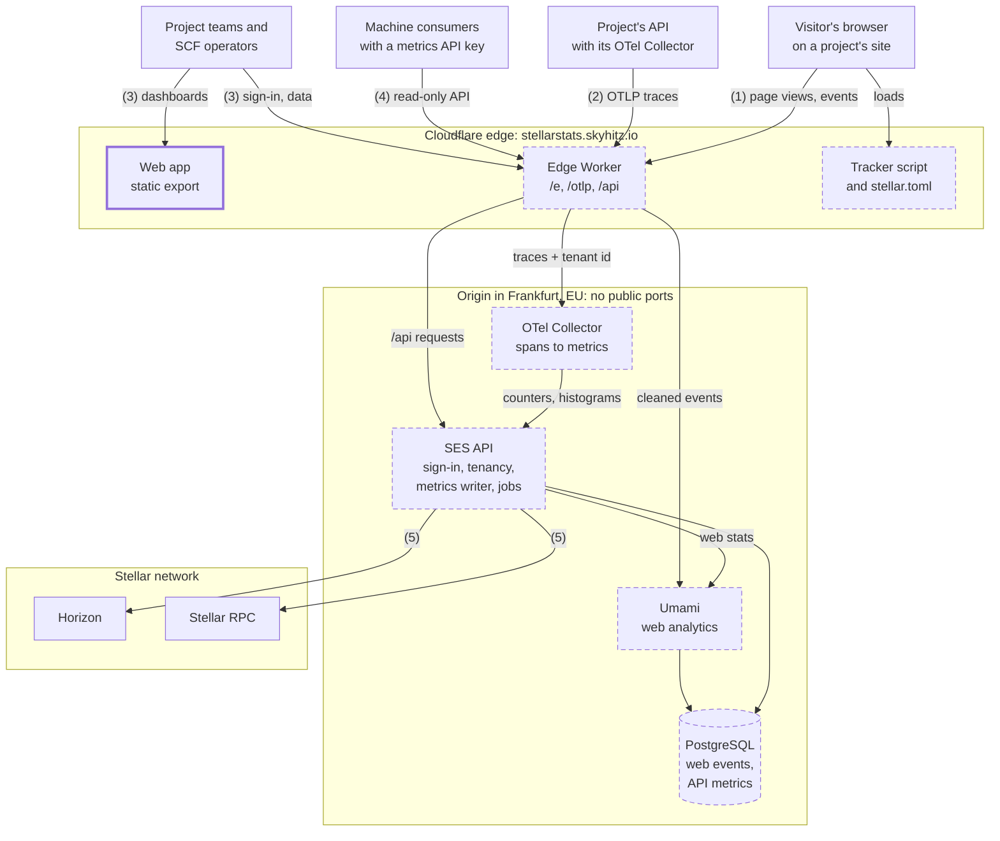
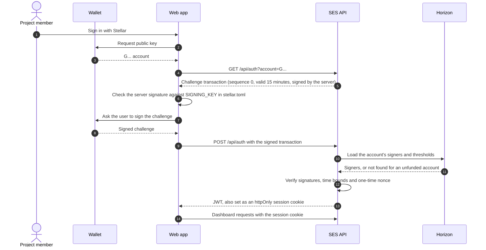

# Stellar Ecosystem Stats: technical architecture

> **Status, November 2026.** The web app is live at https://stellarstats.skyhitz.io
> on demo data. Everything else in this document is the planned design: event
> ingestion, the OpenTelemetry pipeline, sign-in, tenant isolation, the metrics
> API and on-chain activity. Each component below is marked live or planned.
> The API metrics path in section 3.2 (collector config, metrics writer and SQL)
> was tested end to end with OpenTelemetry Collector v0.165 and PostgreSQL 16.
>
> This design answers SCF's RFP "Web and API Analytics for Stellar Ecosystem
> Projects". [Appendix A](#appendix-a-rfp-requirements) maps each requirement to
> the section that covers it.

## Contents

1. [Context and goals](#1-context-and-goals)
2. [System overview](#2-system-overview)
3. [Data flows](#3-data-flows)
4. [Sign-in with Stellar](#4-sign-in-with-stellar)
5. [Tenant isolation and access control](#5-tenant-isolation-and-access-control)
6. [Data model](#6-data-model)
7. [Privacy and data handling](#7-privacy-and-data-handling)
8. [Deployment and operations](#8-deployment-and-operations)
9. [Service levels, support and handover](#9-service-levels-support-and-handover)
10. [Repository layout](#10-repository-layout)
11. [Connecting the web app](#11-connecting-the-web-app)
12. [Key decisions](#12-key-decisions)
13. [Order of work](#13-order-of-work)
14. [Open questions and risks](#14-open-questions-and-risks)

[Appendix A. RFP requirements](#appendix-a-rfp-requirements)

## 1. Context and goals

Stellar Ecosystem Stats (SES) is a shared analytics service for projects funded
by the Stellar Community Fund (SCF). It answers one question for SCF reviewers
and for the projects themselves: how much real usage does each project get? We
build it, run it for 12 months, then hand it over to SCF.

It measures two things:

- **Web analytics**: page views, visitors, sessions, referrers, countries,
  devices and custom events, collected without cookies.
- **API metrics**: request volume, latency and error rates per route, derived
  from the OpenTelemetry traces a project already produces.

| Audience | What they see | How they get in |
| --- | --- | --- |
| Public | Landing page with ecosystem totals, enrollment | No sign-in |
| Tenant (a project team) | Their own web and API dashboards, setup, privacy and erasure | Sign in with a Stellar account linked to the project |
| Operator (SCF) | Every project in one table, side-by-side comparison, admin | Sign in with an operator Stellar account |
| Machine consumer | Aggregated metrics as JSON | Read-only metrics API key |

**Goals**

1. Privacy first: no cookies, no stored IP addresses, no identifier that links
   a visitor across sites or days.
2. One snippet per project: a script tag for websites, a few lines of collector
   config for APIs.
3. Comparable numbers: every project is measured the same way, so the operator
   table compares like with like.
4. Strict tenant isolation: a project sees only its own data.
5. Stellar-native identity: sign in with a Stellar account, no passwords.
6. Free for projects and SCF, and cheap enough to run that it stays that way.
7. Open source, built on maintained open-source components.
8. Reliable: 99.99% ingestion and 99.9% dashboard availability during the
   service window (section 9).
9. Easy to hand over: one monorepo with infrastructure-as-code, so SCF can
   rebuild everything from it.

**Non-goals**

- Not an APM or tracing tool. Projects keep their own APM. SES keeps only
  counters and histograms and drops every span.
- Not product analytics: no user profiles, funnels or session replay.
- Not a network-wide indexer: on-chain data covers only the accounts and
  contracts that projects register.

## 2. System overview



**How to read it:** the thick border is live today, dashed borders are planned,
and plain boxes are outside parties. The numbers match the flows in section 3.

The system has three zones:

- **Cloudflare edge** (global). Serves the web app and the tracker, and is the
  only public entry point. It filters events, checks keys and forwards requests
  to the origin. It keeps no event data, apart from a buffer in an EU-only
  storage bucket while the origin is unreachable.
- **Origin in Frankfurt** (EU). Runs the analytics engines and the SES API and
  holds all stored data. It has no public ports: Cloudflare Tunnel connects it
  to the edge.
- **Stellar network.** Horizon and Stellar RPC, used for sign-in checks and
  on-chain activity.

| Component | Technology | Responsibility | Status |
| --- | --- | --- | --- |
| Web app | Next.js 16, React 19, TypeScript, CSS Modules, static export | Public site, tenant dashboards, operator console | Live, demo data |
| Edge Worker | Cloudflare Workers, Workers KV, R2 (EU), Workers Analytics Engine | Serves static files, event gateway, OTLP gateway, buffer during origin outages, proxy to the SES API | Planned |
| Tracker | Small browser script built from Umami's MIT-licensed tracker | Sends page views and custom events | Planned |
| Umami | Umami, self-hosted at a pinned version | Stores web events, computes web stats | Planned |
| OpenTelemetry Collector | Custom collector build (core and contrib components) | Turns project spans into request counts and latency histograms, then drops the spans | Planned, tested end to end |
| SES API | TypeScript on Node.js | SEP-10 sign-in, tenancy, enrollment, keys, erasure, read API, metrics writer, scheduled jobs | Planned, writer prototyped |
| PostgreSQL | Managed PostgreSQL in Frankfurt | `umami` database (Umami's own) and `ses` database (ours, including API metrics) | Planned, schema tested |

## 3. Data flows

### 3.1 Web events (flow 1)

1. **Load.** The project's page loads the tracker from
   `https://stellarstats.skyhitz.io/v/{version}/app.js`. Every version has its
   own immutable URL, the tag carries a Subresource Integrity hash, and the
   script never loads other code, so it can't change under a project without
   them editing the tag. Each release's hash is published in the changelog. The
   response sends `Access-Control-Allow-Origin: *`, which the tag's
   `crossorigin="anonymous"` needs for the integrity check to pass.
2. **Send.** The tracker posts page views (client-side route changes included,
   through the History API) and custom events to `POST /e`, tagged with the
   project's `data-site` id.
   - It reads only the page URL and the referrer. It never reads screen size or
     language.
   - It sends nothing when the visitor has opted out (a flag set only when they
     opt out on the project's privacy page) or when the browser sends Global
     Privacy Control.
   - An optional one-line helper for Stellar Wallets Kit sends a
     `wallet_connect` event with the wallet type, never the address.
3. **Filter at the edge.** The Edge Worker runs these steps in order:

   | Step | What happens |
   | --- | --- |
   | Site check | Looks up `data-site` in KV. The site must be active, and the request's `Origin` must match the domain registered at enrollment. |
   | Browser check | Rejects requests without browser fetch metadata (`Sec-Fetch-*` headers), with bot user agents or from known datacenter networks, and applies rate limits. This is the "events are only accepted from browser execution" rule on the Setup screen. Each rejection is counted per site and reason in Workers Analytics Engine, and that count is the operator table's Bot % column. |
   | Allowlist fields | Keeps the page path but drops the query string and fragment, and reduces the referrer to its domain. Drops page title, screen size, language and Umami's visitor `id` field if a modified tracker sends them. Only the `event` type is accepted, so `identify` calls are refused. |
   | Pseudonymize | Replaces the visitor's IP with HMAC-SHA-256 over the site id and the IP, keyed with a random key for the current UTC day. The SES API creates each day's key in advance, and KV deletes it one hour after its day ends. Once the key is gone, nobody, including us, can map a stored session back to an IP. |
   | Country | Sets the `cf-ipcountry` header from Cloudflare's own lookup (`request.cf.country`). Region and city are never forwarded. |
   | Forward | Sends the event to Umami's `/api/send` through the tunnel, with the pseudonym in the header Umami reads the client IP from. |
   | Buffer | If the origin can't be reached, writes the cleaned event to an R2 bucket restricted to the EU. A job replays it when the origin is back. |

4. **Store.** Umami derives a session from the pseudonym and the user agent,
   parses browser and device class, and writes the event to PostgreSQL. Umami
   runs with these settings:

   | Setting | Value | Why |
   | --- | --- | --- |
   | `SALT_ROTATION` | `day` | Session ids change at every UTC day boundary |
   | `CLIENT_IP_HEADER` | `x-ses-visitor` | Umami hashes the edge's pseudonym and never sees an IP |
   | `DISABLE_TELEMETRY` | `1` | No calls home |
   | `PRIVATE_MODE` | `1` | Blocks Umami's external network calls |

**Ad blockers.** The names `/v/{version}/app.js` and `/e` avoid the patterns ad
blockers filter on, and CI checks them against EasyList and EasyPrivacy. A
project that also wants to avoid blocking by domain can serve both from its own
domain through a proxy rule.

The result: the full IP never leaves Cloudflare's edge, and sessions can't be
linked across sites or days.

### 3.2 API metrics (flow 2)

1. **Export.** The project's own OpenTelemetry Collector keeps exporting to its
   APM and adds a second exporter to `https://stellarstats.skyhitz.io/otlp`,
   with its ingest key in the `x-tenant-key` header. This is the snippet on the
   Setup screen. OTLP over HTTP appends the signal path, so spans arrive at
   `/otlp/v1/traces`.
2. **Check the key at the edge.** The Edge Worker hashes the key, looks the hash
   up in KV and refuses unknown or revoked keys with `401`. It applies a
   per-project rate limit and body size cap, removes the key header and adds
   `x-ses-tenant: <project id>`. Only `/otlp/v1/traces` is accepted, so logs and
   metrics endpoints never reach the origin. If the origin can't be reached,
   the batch goes to the EU buffer and is replayed later.
3. **Convert spans to metrics.** The collector keeps server spans, plus client
   spans that our Stellar instrumentation marks (see 3.4). It stamps the tenant
   from the edge's header, normalizes routes, turns spans into a request counter
   and a latency histogram, and drops the spans. Every minute it sends only the
   counts since its previous flush (delta temporality) to the metrics writer:

```yaml
receivers:
  otlp:
    protocols:
      http:
        endpoint: 0.0.0.0:4318
        include_metadata: true # lets processors read the tenant header set by the edge

processors:
  memory_limiter:
    check_interval: 1s
    limit_percentage: 80
    spike_limit_percentage: 20

  # Keep server spans, plus client spans our Stellar instrumentation marks.
  # Everything else is dropped here and never reaches storage.
  filter/keep:
    error_mode: ignore
    traces:
      span:
        - 'kind != SPAN_KIND_SERVER and attributes["stellar.api"] == nil'

  # The tenant comes from the key the edge verified, never from the payload.
  attributes/tenant:
    actions:
      - key: ses.tenant
        from_context: metadata.x-ses-tenant
        action: upsert

  transform/routes:
    error_mode: ignore
    trace_statements:
      # Drop resource attributes such as host and pod names, which would
      # create a new series every deploy.
      - context: resource
        statements:
          - keep_keys(attributes, ["service.name"])
      # Built-in path normalization, as listed on the Setup screen.
      - context: span
        statements:
          - set(attributes["http.route"], attributes["url.path"]) where attributes["http.route"] == nil
          - replace_pattern(attributes["http.route"], "G[A-Z2-7]{55}", "{g_address}")
          - replace_pattern(attributes["http.route"], "M[A-Z2-7]{68}", "{m_address}")
          - replace_pattern(attributes["http.route"], "C[A-Z2-7]{55}", "{c_address}")
          - replace_pattern(attributes["http.route"], "[0-9a-fA-F]{64}", "{hash}")
          - replace_pattern(attributes["http.route"], "[0-9a-fA-F]{8}-[0-9a-fA-F]{4}-[0-9a-fA-F]{4}-[0-9a-fA-F]{4}-[0-9a-fA-F]{12}", "{uuid}")
          - replace_pattern(attributes["http.route"], "/[0-9]+\\b", "/{id}")
          - replace_pattern(attributes["http.route"], "(.)/$", "$$1")

  batch: {}

connectors:
  spanmetrics:
    namespace: ses
    aggregation_temporality: AGGREGATION_TEMPORALITY_DELTA # each flush carries only new counts
    metrics_flush_interval: 60s
    histogram:
      unit: ms
      explicit:
        buckets: [10ms, 25ms, 50ms, 100ms, 250ms, 500ms, 1s, 2.5s, 5s, 10s]
    exclude_dimensions: [span.name, collector.instance.id] # raw paths; per-restart ids
    dimensions:
      - name: ses.tenant
      - name: http.request.method
      - name: http.route
      - name: http.response.status_code
      - name: stellar.api
      - name: stellar.method

exporters:
  # The metrics writer (part of the SES API) adds each flush to hourly rows in PostgreSQL.
  otlphttp/writer:
    endpoint: http://ses-api:4319
    encoding: json

service:
  pipelines:
    traces:
      receivers: [otlp]
      processors: [memory_limiter, filter/keep, attributes/tenant, transform/routes]
      exporters: [spanmetrics] # spans end here: nothing exports or stores them
    metrics:
      receivers: [spanmetrics]
      processors: [batch]
      exporters: [otlphttp/writer]
```

4. **Store.** The collector has no PostgreSQL exporter, so a small metrics
   writer in the SES API receives its output on an internal port. It adds each
   flush to one row per project, hour, route and status code:

```sql
-- One row per project, hour, service, route and status code. Counts add up.
CREATE TABLE api_metrics_hourly (
  tenant          text             NOT NULL,
  hour            timestamptz      NOT NULL,
  service         text             NOT NULL DEFAULT '',
  span_kind       text             NOT NULL,  -- 'server', or 'client' for Stellar calls
  method          text             NOT NULL DEFAULT '',
  route           text             NOT NULL DEFAULT '',
  status_code     smallint         NOT NULL DEFAULT 0,
  stellar_api     text             NOT NULL DEFAULT '',
  stellar_method  text             NOT NULL DEFAULT '',
  requests        bigint           NOT NULL,
  duration_ms_sum double precision NOT NULL,
  buckets         bigint[]         NOT NULL, -- requests per latency bucket, same bounds as the collector
  PRIMARY KEY (tenant, hour, service, span_kind, method, route, status_code, stellar_api, stellar_method)
) PARTITION BY RANGE (hour);

-- Monthly partitions: a job creates the next ones and drops those older than 24 months.
CREATE TABLE api_metrics_hourly_2026_11 PARTITION OF api_metrics_hourly
  FOR VALUES FROM ('2026-11-01') TO ('2026-12-01');
```

Request counts, latency sums and bucket counts add up across flushes, so each
row is final once its hour ends. Monthly partitions turn the 24-month retention
into dropping old partitions. Two helpers do the math: `sum_buckets` adds bucket
counts across rows, and `bucket_quantile` interpolates a percentile inside a
bucket, the same method Prometheus uses.

The API dashboard needs only a few queries. The SES API sets the tenant itself,
from the signed-in session:

```sql
-- Requests, p95 latency and error rate for the selected range.
-- Error rate is the share of 5xx responses; 4xx is shown separately as a status class.
SELECT sum(requests) AS requests,
       bucket_quantile(0.95, '{10,25,50,100,250,500,1000,2500,5000,10000}', sum_buckets(buckets)) AS p95_ms,
       100.0 * sum(requests) FILTER (WHERE status_code >= 500) / sum(requests) AS error_rate
FROM api_metrics_hourly
WHERE tenant = $1 AND span_kind = 'server' AND hour >= now() - interval '30 days';

-- p50 and p95 latency per route
SELECT method, route, sum(requests) AS requests,
       bucket_quantile(0.50, '{10,25,50,100,250,500,1000,2500,5000,10000}', sum_buckets(buckets)) AS p50_ms,
       bucket_quantile(0.95, '{10,25,50,100,250,500,1000,2500,5000,10000}', sum_buckets(buckets)) AS p95_ms
FROM api_metrics_hourly
WHERE tenant = $1 AND span_kind = 'server' AND hour >= now() - interval '30 days'
GROUP BY method, route
ORDER BY requests DESC;

-- Status code distribution
SELECT status_code / 100 AS status_class, sum(requests) AS requests
FROM api_metrics_hourly
WHERE tenant = $1 AND span_kind = 'server' AND hour >= now() - interval '30 days'
GROUP BY status_class
ORDER BY status_class;
```

**What the end-to-end test showed.** Sample spans went through the config
above, a prototype writer and PostgreSQL 16, and came out as expected:

- `/v1/accounts/GA7Q…` was stored as `/v1/accounts/{g_address}`,
  `/tracks/48213/` as `/tracks/{id}`, and a 64-character hex hash as `{hash}`.
  `/2fa` was left alone.
- An internal span was dropped.
- A span that claimed `ses.tenant="spoofed"` was stored under the tenant from
  the verified key.
- Host names never reached storage.
- The queries returned the request count, the 5xx share, the status classes and
  the p95 per route. Every number matched an earlier run of the same spans
  through a Prometheus-compatible database.

**Sizing.** The RFP's design target is about 1 million requests a day across
all projects, about 12 per second on average. The collector counts in memory,
so the writer's load depends on the number of active route and status
combinations, not on traffic. With 1,000 combinations, the writer upserts up to
1,000 rows a minute, and storage grows by about 9 million rows a year, a few
gigabytes. A load test at the target volume is part of milestone 2.

**Things projects need to know**

- **Sampling.** Counts are only correct if SES receives every server span. A
  project that samples traces should sample in its own APM pipeline, after the
  SES exporter, not in its SDK. As an alternative input later, SES can accept
  the standard `http.server.request.duration` histogram directly.
- **Cardinality.** Normalization keeps routes bounded. A daily job checks how
  many distinct routes each project produces and flags any project whose paths
  aren't normalizing, so an operator can add a rule.

### 3.3 Dashboards and the metrics API (flows 3 and 4)

- **The web app stays static.** It is served from the edge, and after sign-in,
  screens fetch their data from the SES API under `/api`. Same origin, so the
  session cookie applies and no CORS setup is needed.
- **Tenant screens.** The SES API calls Umami's API
  (`/api/websites/{id}/stats`, `/pageviews`, `/metrics?type=referrer|country|device|browser`)
  and queries `api_metrics_hourly`, then shapes the results into the types the
  screens already use (`WebAnalytics` and `ApiAnalytics` in
  `apps/web/src/data`). The Umami website id and the tenant come from the
  session's project, never from the request.
- **Operator screens and the public landing page.** These read a rollup table
  refreshed every hour: for each project and each range (7D, 30D, 90D, 12M),
  the operator table columns. Unique visitors don't add up across days, so the
  rollup stores per-range values rather than daily sums. 24H is queried live.
  Projects above 15% bot share or 1.5% error rate are flagged, as in the demo.
- **Metrics API.** Machine consumers call `GET /api/v1/...` with
  `Authorization: Bearer ses_live_...` and get the same aggregates as JSON,
  read-only.

| Group | Endpoints | Who can call |
| --- | --- | --- |
| Sign-in | `GET` and `POST /api/auth` (SEP-10), `GET` and `POST /api/auth/contracts` (SEP-45, later), `POST /api/logout`, `GET /api/session` | Anyone |
| Enrollment | `POST /api/enrollments`, `GET /api/projects/{id}/first-event` | Signed in |
| Tenant data | `GET /api/projects/{id}/web`, `/api` and `/onchain`, each with `?range=` | Project members |
| Tenant settings | Ingest keys, linked accounts and contracts, members, erasure requests | Project owners and members |
| Operator | `GET /api/ecosystem?range=`, `GET /api/ecosystem/compare?ids=`, enrollment mode, project removal and restore, metrics API keys | Operators |
| Metrics API | `GET /api/v1/projects`, `GET /api/v1/projects/{id}/metrics?range=` | Metrics API key |

### 3.4 On-chain activity (flow 5)

- **Linking.** Projects link the Stellar accounts and Soroban contracts they
  own. An account is linked by signing in with it, since SEP-10 already proves
  control. A contract is linked by a project member and confirmed by an
  operator.
- **Sync.** A job runs every 5 minutes. For accounts, it pages through Horizon
  (`/accounts/{id}/transactions`) from a stored cursor. For contracts, it reads
  Stellar RPC `getEvents`, filtered by contract id, from the last processed
  ledger. RPC keeps only a limited window of history, so the job runs
  continuously and stores what it reads.
- **Storage.** The job writes daily aggregates (transactions, operations,
  contract events and unique accounts) to `onchain_daily`, which feeds an
  on-chain panel next to the web and API numbers.
- **Stellar call metrics.** A small instrumentation package wraps the Horizon
  and RPC clients in `@stellar/stellar-sdk` and creates client spans marked
  `stellar.api` (`horizon` or `rpc`) and `stellar.method` (the RPC method, or
  the Horizon route). The collector config keeps these spans, so projects see
  latency and errors on their Stellar calls separately from their own API.

## 4. Sign-in with Stellar

Users sign in by proving control of a Stellar account with
[SEP-10](https://github.com/stellar/stellar-protocol/blob/master/ecosystem/sep-0010.md).
They sign a challenge in their wallet, and nothing is submitted to the network
and no fees are paid.



- **stellar.toml.** Served at `/.well-known/stellar.toml` as a static file with
  `Access-Control-Allow-Origin: *`, as SEP-1 requires. It publishes
  `WEB_AUTH_ENDPOINT = "https://stellarstats.skyhitz.io/api/auth"` and
  `SIGNING_KEY`, and later `WEB_AUTH_FOR_CONTRACTS_ENDPOINT` and
  `WEB_AUTH_CONTRACT_ID` for SEP-45.
- **Challenge.** Built with the WebAuth helpers in `@stellar/stellar-sdk`:
  sequence number 0 so it can never execute, time bounds of 15 minutes, a
  `stellarstats.skyhitz.io auth` manage data operation carrying a random nonce,
  and a `web_auth_domain` operation.
- **Verification.** For an existing account, the signatures must meet the
  account's signer weights, so multisig accounts work. For an unfunded account,
  the master key must have signed. Each challenge can be used once.
- **Session.** The JWT (`iss`, `sub` = the account, `iat`, `exp` after 12 hours)
  is returned in the body, as SEP-10 specifies, and also set as an `httpOnly`,
  `Secure`, `SameSite=Strict` cookie, so page scripts never handle it. Roles are
  not stored in the token: the SES API looks up memberships and operator status
  on every request, so removing someone takes effect immediately.
- **Signing key.** A dedicated keypair with no funds, kept as a secret. It is
  rotated by publishing a new `SIGNING_KEY`.
- **Wallets.** Any wallet that can sign a transaction, through Stellar Wallets
  Kit (Freighter, xBull, Lobstr and others).
- **Contract accounts.** Smart wallets such as passkey wallets use contract
  accounts (`C...`), which sign in through
  [SEP-45](https://github.com/stellar/stellar-protocol/blob/master/ecosystem/sep-0045.md).
  The client signs Soroban authorization entries that call `web_auth_verify` on
  our web auth contract, and the server verifies them by simulating the call.
  The session that follows is the same. SEP-45 is still a draft (v0.1.1), so it
  ships after SEP-10.

| Role | Who has it |
| --- | --- |
| Operator | Accounts listed in `operators` |
| Project owner | The account that completed enrollment |
| Project member | Accounts an owner added |

## 5. Tenant isolation and access control

Isolation is enforced in one place, the SES API, and checked at each layer:

- **One read path.** Umami and PostgreSQL have no public endpoints. All reads
  go through the SES API.
- **Server-side identity.** The tenant always comes from a verified key or the
  session, never from the request. The collector overwrites any `ses.tenant`
  attribute a project sends (tested, see 3.2).
- **Scoped queries.** Every API metrics query filters on `tenant`, and every
  Umami call uses the project's website id, both taken from the session by the
  SES API. Every other PostgreSQL query filters by project too.
- **Defense in depth.** The SES API's database role uses PostgreSQL row-level
  security on project data, so a query that forgets its project filter returns
  nothing.
- **Tests.** Every endpoint has a test that asserts another tenant's data
  returns `403`.

| Credential | Format | Used for | Stored as | Lifecycle |
| --- | --- | --- | --- | --- |
| Ingest key | `ses_ingest_` plus random characters | OTLP `x-tenant-key` | SHA-256 hash in PostgreSQL and KV | Created by an owner, shown once, revocable. Revocation reaches the edge within about a minute (KV propagation). |
| Metrics API key | `ses_live_` plus 22 random characters | Read-only metrics API | SHA-256 hash, visible prefix `ses_live_` plus 4 characters | Created by an operator, shown once, revocable |
| Session | JWT | Dashboards | Not stored. Challenge nonces are kept only until they expire. | 12 hours |

## 6. Data model

Umami owns the `umami` database and manages it with its own migrations. The SES
API reads it only through Umami's API, except the erasure and retention jobs,
which delete rows through a dedicated database role.

The `ses` database:

| Table | Key columns | Notes |
| --- | --- | --- |
| `projects` | `id` (slug, the tracker's `data-site`), name, category, domain, contact email, web and API flags, status, Umami website id | Status is `pending`, `active` or `removed` |
| `members` | project id, account (`G...` or `C...`), role | Role is `owner` or `member` |
| `operators` | account, added by, added at | |
| `linked_addresses` | project id, address, kind, verified by, sync cursor | Kind is `account` or `contract` |
| `ingest_keys` | project id, prefix, key hash, created at, revoked at | |
| `api_keys` | prefix, key hash, label, created by, created at, revoked at | Label such as "SCF traction review" |
| `api_metrics_hourly` | tenant, hour, service, span kind, method, route, status code, Stellar API and method, requests, latency sum, latency buckets | Partitioned by month, see 3.2 |
| `erasure_requests` | id (`ER-0013`), project id, scope, target, status, requested by | Status is `queued` or `completed` |
| `settings` | enrollment mode | `self` or `approval` |
| `rollups` | project id, range, operator table columns, computed at | Refreshed hourly |
| `onchain_daily` | project id, day, transactions, operations, contract events, unique accounts | |
| `auth_nonces` | nonce, expires at | One-time challenge nonces |
| `audit_log` | actor, action, target, at | Operator and owner actions |

## 7. Privacy and data handling

| Stored | How it is produced |
| --- | --- |
| Page path and referrer domain | The edge strips query strings, fragments and referrer paths |
| Country | Cloudflare's lookup at the edge. Region and city are never forwarded. |
| Device class and browser family | Umami parses the user agent |
| Session hash that changes daily | Umami with `SALT_ROTATION=day`, computed over a pseudonym whose key is deleted |
| Custom events | Whatever the project sends, erasable by property |

| Never stored | Enforced by |
| --- | --- |
| Cookies or local storage identifiers | The tracker sets none. The only thing it may store is the visitor's own opt-out. |
| Full IP addresses | The edge replaces the IP before forwarding, so the origin never sees one |
| Cross-site or cross-day identifiers | Daily pseudonym key, site id in the pseudonym, Umami's `id` field dropped |
| Screen size and language | The tracker never reads them, and the edge drops them |
| Traces, spans and logs | The collector has no trace or log exporter, and the edge accepts only `/otlp/v1/traces` |

- **Retention.** Web events and API metrics are kept for 24 months. A nightly
  job deletes older web events, and API metrics partitions older than 24 months
  are dropped. Database backups are kept for 30 days, so erased data leaves the
  backups within 30 days. Buffered payloads are deleted as soon as they're
  replayed.
- **Erasure.** Visitors can't be identified, since the daily key that could
  link them is deleted, so erasure requests come from projects for the data
  they sent. Requests are queued, run by a job, then marked `completed`, and
  the rollups are recomputed.

  | Scope | Web data (Umami) | API metrics |
  | --- | --- | --- |
  | Custom event property | Deletes the matching event data | Not applicable: no custom properties |
  | Date range | Deletes the site's events in the range | Deletes the project's rows in the range |
  | All data for this site | Deletes all of the site's events | Deletes all of the project's rows |

- **Data residency.** All stored data stays in Frankfurt, and the edge buffer is
  an R2 bucket restricted to the EU. The edge processes requests worldwide but
  stores nothing else: KV holds only the site registry, key hashes and the
  daily pseudonym key, and Analytics Engine holds only rejection counts per
  site.

**Consent and jurisdictions.** The RFP asks for GDPR compliance without a
client-side opt-in. Two sets of rules apply: GDPR, and the ePrivacy Directive's
consent rule for reading or storing information on a device. The EDPB's
guidelines on that rule (2/2023, version 2.0, October 2024) say JavaScript that
makes the browser send information falls within it, so being cookieless doesn't
settle the question on its own. Exemptions for privacy-friendly analytics come
from national rules, so the design meets the strictest common conditions:
measurement only, anonymous aggregate statistics, no cross-site tracking, no
reuse of the data for our own purposes, and a visitor opt-out.

- **France:** designed for the CNIL's audience measurement exemption.
- **UK:** designed for the analytics exemption added by the Data (Use and
  Access) Act 2025, in force since February 2026.
- **Rest of the EU and EEA:** positions differ, and some regulators (German
  ones, for example) have generally treated analytics as needing consent. The
  compliance statement will list where no opt-in is compliant and where it
  isn't, after legal review.

The SCF view has to fit the "no reuse" condition: under the enrollment terms,
each project shares its own anonymous aggregate statistics with SCF.

## 8. Deployment and operations

**Edge** (live for the web app)

- Worker `stellar-ecosystem-stats` on the custom domain
  `stellarstats.skyhitz.io`, configured in `apps/web/wrangler.jsonc`. Today it
  serves the Next.js static export as static assets.
- Planned: Worker code for `/e`, `/otlp/*` and `/api/*`, run before the asset
  lookup only for those paths (`assets.run_worker_first`). Bindings for KV, an
  R2 bucket in the EU jurisdiction, Analytics Engine and rate limiting, plus
  the tunnel's service token as a secret.
- Headers: `/_next/static/*` immutable (live), `/v/*` immutable with
  `Access-Control-Allow-Origin: *`, and `/.well-known/stellar.toml` with
  `Access-Control-Allow-Origin: *`.

**Origin** (planned)

- One Frankfurt VM to start, running Docker Compose: `umami`, `ses-api` (with
  the metrics writer), `ses-jobs`, `otel-collector` and `cloudflared`, with
  managed PostgreSQL in the same region and point-in-time recovery.
- No public inbound ports. `cloudflared` opens an outbound tunnel, and requests
  from the Worker carry a Cloudflare Access service token.
- Umami's own admin interface is reachable only by operators through Cloudflare
  Access, for debugging.
- Scale vertically first, then move the collector to its own host.

**Infrastructure as code.** Cloudflare resources (Worker, KV, R2, DNS, Tunnel
and Access) are defined with OpenTofu, and the origin with Docker Compose, all
in the monorepo, so SCF can rebuild the whole system from it.

**Scheduled jobs** (`ses-jobs`)

| Job | Schedule | What it does |
| --- | --- | --- |
| Rollups | Hourly | Recomputes the per-project, per-range figures |
| On-chain sync | Every 5 minutes | Reads Horizon and Stellar RPC into `onchain_daily` |
| Erasure | Every minute | Runs queued erasure requests |
| Retention | Nightly | Deletes web events older than 24 months |
| Partitions | Monthly | Creates next month's API metrics partition and drops those older than 24 months |
| Buffer replay | Every minute while the buffer isn't empty | Re-sends buffered payloads to the origin, oldest first |
| Pseudonym key | Daily | Writes the next UTC day's key to KV, set to expire an hour after that day ends |
| KV sync | On every change, plus an hourly full pass | Site registry, key hashes and project status |
| Cardinality check | Daily | Flags projects whose routes aren't normalizing |

**CI/CD** (planned). GitHub Actions runs lint, typecheck, tests, builds,
`otelcol validate` and the ad-blocker check on tracker names on every pull
request. On merge, it deploys the edge with `wrangler deploy` and rolls out new
origin images. Today, deploys are manual with `pnpm run deploy`.

**Monitoring SES itself.** External uptime checks hit `/e`, `/otlp` and the
dashboard every minute. Alerts cover ingest errors, spans refused by the
collector, a growing edge buffer, PostgreSQL disk usage, and rollups that stop
refreshing. The services' own health metrics go through the same pipeline under
an internal tenant.

## 9. Service levels, support and handover

The RFP asks us to run the service for 12 months from SCF's approval of the
final tranche, then hand it over.

| Target | Commitment | How the design meets it |
| --- | --- | --- |
| Ingestion availability | 99.99% | Ingestion runs on Cloudflare's edge, which accepts events and spans even when the origin is down, buffers them in the EU and replays them |
| Dashboard availability | 99.90% | The app is static on the edge. The origin uses managed PostgreSQL with point-in-time recovery and can be rebuilt from the monorepo. |
| Critical and high vulnerabilities | Patched within 24 hours | Automated dependency and container image scanning, with alerts to the maintainers |
| Support tickets | Answered within 5 business days, resolved within 10 | Public GitHub issue tracker |

**Handover**, between months 6 and 12 of the service window, when SCF decides:

1. Transfer the GitHub repository to SCF.
2. SCF rebuilds the infrastructure in its own accounts from the monorepo
   (OpenTofu and Docker Compose).
3. Migrate the data: dump the `umami` and `ses` databases, restore them into
   SCF's PostgreSQL, and check the totals per project.
4. Switch traffic. `stellarstats.skyhitz.io` is a subdomain of skyhitz.io, so it
   can't be transferred: it becomes a permanent redirect or forwarding rule to
   SCF's domain, so existing tracker tags and collector configs keep working
   while projects update them.
5. Rotate the secrets, including the SEP-10 signing key, to keys SCF controls.

## 10. Repository layout

```text
apps/
  web/            Next.js app: public site, tenant dashboards, operator console (live)
  edge/           Cloudflare Worker: gateway, buffer and static assets (planned; the deploy config moves here)
  api/            SES API, metrics writer and scheduled jobs (planned)
packages/
  tracker/        Browser tracker built from Umami's MIT-licensed tracker, keeping its notice (planned)
  otel-stellar/   OpenTelemetry instrumentation for Horizon and Stellar RPC calls (planned)
infra/
  cloudflare/     OpenTofu for the Worker, KV, R2, DNS, Tunnel and Access (planned)
  collector/      Collector build manifest and config (planned)
  origin/         Docker Compose for the Frankfurt host (planned)
docs/
  ARCHITECTURE.md This document
                  Runbooks, onboarding guide, compliance statement and handover plan (planned)
```

## 11. Connecting the web app

The UI was built so a backend can replace the demo data without changing the
screens. These are the changes:

- **Data modules.** The functions in `apps/web/src/data` keep their return
  types but become async calls to the SES API. Screens gain loading and error
  states, since the functions are synchronous today.
- **Roles.** The Public / Tenant / Operator switch in the header is replaced by
  the signed-in session's role, and `TENANT_PROJECT` comes from the session.
- **Enrollment.** A "Connect wallet" step comes first, and that account becomes
  the project owner. When a project measures both its website and its API, the
  install step shows both snippets (today it shows only the script tag). The
  Verify step polls `/api/projects/{id}/first-event` instead of "Simulate first
  event".
- **Admin.** Keys are issued by the API, which replaces `createDemoKey`.
  Removing a project sets its status to `removed`, and the edge stops accepting
  its data within about a minute.
- **Setup placeholders.** In `apps/web/src/data/setup.ts`, the domain becomes
  `stellarstats.skyhitz.io`, the tracker versions and integrity hash become
  real, and the OTLP endpoint becomes `https://stellarstats.skyhitz.io/otlp`.
- **Privacy copy.** `apps/web/src/data/privacy.ts` is updated to match
  section 7. "No opt-in needed: EU/EEA, UK" becomes the jurisdiction statement,
  and "24 months+" becomes "24 months".

## 12. Key decisions

| Decision | Why | Trade-off |
| --- | --- | --- |
| Umami for web analytics | It's cookieless and privacy-first, MIT-licensed, built for many sites under one operator, and light to run on just TypeScript and PostgreSQL, so we can offer it free to every SCF project. | Its defaults are looser than our promise (region and city, monthly salt), so the edge and configuration enforce the stricter rules. |
| API metrics derived from spans in our collector | Projects already export traces. Adding an exporter needs no code changes and keeps their APM. | Spans travel over the network, and counts depend on unsampled spans (see 3.2). |
| PostgreSQL for API metrics | The RFP specifies it. Its target of about 1 million requests a day is small for PostgreSQL once the collector has done the counting, and one database is simpler to back up, run and hand over. | The collector has no PostgreSQL exporter, so we maintain a small writer. A dedicated time-series database such as VictoriaMetrics would scale further, but it adds a second datastore. |
| Privacy enforced at the edge, not by patching Umami | Umami stays upstream and easy to upgrade, and full IPs never reach the origin. | Relies on Umami's documented settings, which must be rechecked on every Umami upgrade. |
| Static web app with a separate API, on one domain | The app is fully prerendered, so static assets are fast and simple. We tried the OpenNext adapter for running Next.js on Workers, and requests hung with Next.js 16.4. | Data loads in the browser after sign-in, so screens need loading states. |
| Sign-in with SEP-10, then SEP-45 | Identities match the accounts projects already use with SCF, and there are no passwords to store. | Every user needs a Stellar wallet, which fits this audience. |
| One EU region for storage, with an EU buffer at the edge | Matches the data residency in the compliance statement. The edge keeps ingestion fast worldwide and available during origin outages. | Dashboards depend on the single origin, which is why their target is 99.9% rather than 99.99%. |

## 13. Order of work

| Milestone | Due | Scope | Outcome |
| --- | --- | --- | --- |
| 0, done | | Web app on demo data, deployed | Live at stellarstats.skyhitz.io |
| 1 (tranche 1) | Dec 18, 2026 | EU infrastructure as code, edge gateway, tracker, Umami, SEP-10 sign-in, enrollment | Skyhitz sends real web data, tenant web dashboard on live data |
| 2 (tranche 2) | Jan 18, 2027 | OTLP ingestion, collector, metrics writer, API dashboard, Stellar call instrumentation, Wallets Kit events | Skyhitz's API metrics live, instrumentation published on npm |
| 3 (tranche 3) | Feb 18, 2027 | Operator console and metrics API on live data, on-chain activity, erasure and retention, edge buffer, monitoring, documentation | Mainnet launch with at least 3 SCF projects on web analytics and 1 on API analytics |
| Service window | 12 months from SCF's approval of tranche 3 | Hosting, support and security patches | Service levels in section 9 |
| Handover | Months 6 to 12 of the window | Repository, infrastructure and data | SCF runs the service |

## 14. Open questions and risks

1. **Hosting provider** for the Frankfurt origin.
2. **Domain.** `stellarstats.skyhitz.io` can only be redirected at handover,
   not transferred. A dedicated domain from the start would make the handover
   cleaner.
3. **Consent position.** The jurisdiction list in the compliance statement needs
   legal review (section 7).
4. **Privacy copy.** The privacy screen says country is "derived from an IP with
   the last octet dropped". With this design, the IP never leaves the edge,
   which is stronger but needs different wording. Umami also records the
   operating system from the user agent, which should either be added to the
   stored list or stripped at the edge.
5. **Public figures.** The landing page shows page views per project. Which
   figures may be public, and should projects opt in?
6. **Contract ownership.** Contracts are confirmed by an operator today. Can
   ownership be verified automatically, for example from the contract's admin
   or deployer?
7. **On-chain backfill.** Horizon covers account history, but contract events
   older than RPC's window need another source, such as SDF's Hubble dataset.
8. **Spike before building.** Check against the pinned Umami version that it
   reads the country from `cf-ipcountry`, accepts the pseudonym in
   `CLIENT_IP_HEADER`, and never falls back to a GeoIP lookup on it.

## Appendix A. RFP requirements

| RFP requirement | Where it's covered |
| --- | --- |
| Multi-tenant platform that SCF runs as a shared service, built on Umami or GoatCounter with a stated rationale | 1, 2, 12 |
| Events only from frontend instrumentation, with bot mitigation that tells browser execution from server-side posts | 3.1 |
| Easy integration for static HTML, single-page apps and server-rendered sites | 3.1, Setup screen |
| Versioned, pinned tracker with no remote updates, and a supply-chain defense | 3.1 |
| Tracker and endpoint names that avoid ad blockers | 3.1 |
| GDPR compliance without client-side opt-in, with non-compliant jurisdictions stated, data residency declared and tenant-triggered erasure | 7 |
| Page views, unique visitors, referrers, session duration, bounce rate, country, device and browser | 3.1, 3.3 |
| Custom events and Stellar Wallets Kit capture (nice to have) | 3.1 |
| Private tenant dashboard and global operator dashboard with filtering, sorting and comparison | 3.3 |
| OpenTelemetry dual export, with traces, spans and logs discarded and counters and histograms stored in PostgreSQL | 3.2 |
| Tenant and service, normalized route, status code and latency, with hard-coded normalization rules | 3.2 |
| About 1 million requests a day, with aggregates kept at least 24 months | 3.2, 7 |
| Request volume, status code distribution and p50/p95 latency per tenant, compared across projects | 3.2, 3.3 |
| Strict tenant isolation, with global-view credentials for SCF operators | 4, 5 |
| Self-service enrollment, removal of non-ecosystem projects and an approval mode | 3.3, 6, 11 |
| API keys for machine consumers, generated and revoked by operators | 3.3, 5 |
| Zero fees | 1 |
| Monorepo with code, infrastructure-as-code, docs, runbooks, onboarding guide, tests, compliance docs and monitoring | 8, 10 |
| Live adoption: at least 3 SCF projects on web analytics and 1 on API analytics, with operator and tenant views | 13 |
| 12-month hosting and support window, service levels and handover | 9 |
| OSI-approved open-source license | MIT, see [`LICENSE`](../LICENSE) |
